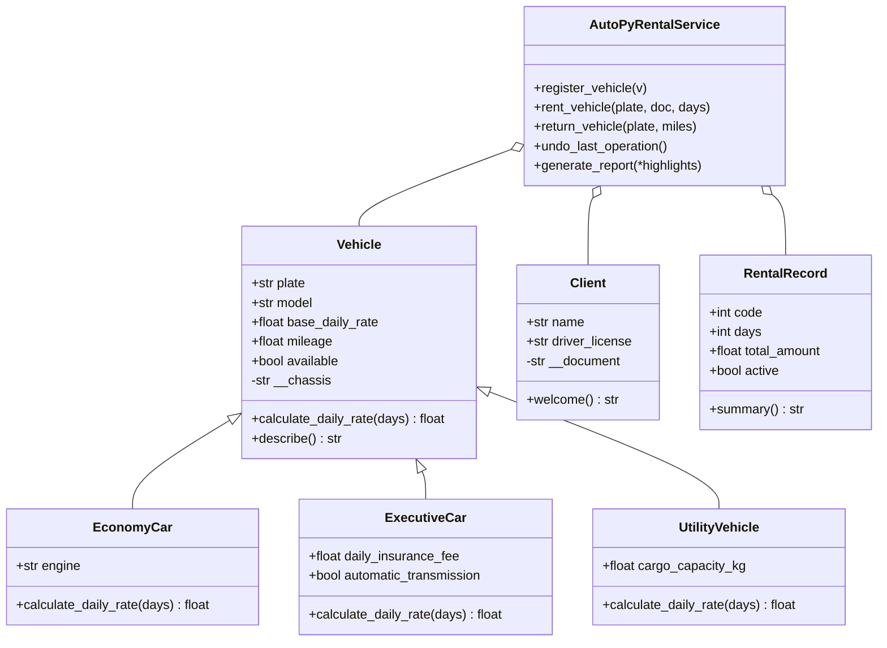

# Capstone Final Project — **AutoPy** Fleet & Rental System

**AutoPy** is the comprehensive capstone project for *Python from Zero to Object-Oriented Programming*. It brings together every concept from Modules 1 through 5 in a clean, modularized fleet management, client registration, rental billing, and reporting package.

---

## Package Architecture

```text
final_project/
├── README.md          # Architecture, module integration map, and CLI guide
├── main.py            # Executable entry point (--demo or interactive CLI)
└── autopy/
    ├── __init__.py    # Public package exports
    ├── exceptions.py  # Custom exception hierarchy (AutoPyError)
    ├── models.py      # Vehicle, EconomyCar, ExecutiveCar, UtilityVehicle, Client, RentalRecord
    ├── services.py    # AutoPyRentalService, LIFO undo stack, sets, recursion, and reports
    └── cli.py         # Argparse CLI, automated --demo runner, and interactive menu
```

### Class Diagram (OOP)



---

## Five-Module Integration Map

| Module | Concepts Applied in AutoPy | Source File |
|---|---|---|
| **Module 1** | Core types (`str`, `int`, `float`, `bool`), explicit type casting, clean variables | [models.py](autopy/models.py) |
| **Module 2** | String normalization (`.strip()`, `.upper()`), alignment (`.center()`), conditionals & loops | [models.py](autopy/models.py), [services.py](autopy/services.py) |
| **Module 3** | Dictionaries (`_fleet`, `_clients`), lists (`_rentals`), tuples (`summary_tuple`), sets (`registered_categories`, `available_categories`, `sold_out_categories`), LIFO stack (`_operation_stack`), `*args` & `**kwargs` | [services.py](autopy/services.py) |
| **Module 4** | Modular package (`autopy/`), `try`/`except`/`else`/`finally`, custom exceptions | [exceptions.py](autopy/exceptions.py), [services.py](autopy/services.py) |
| **Module 5** | Inheritance with `super().__init__()`, polymorphic `calculate_daily_rate()`, encapsulation (`@property` + `__chassis` name mangling), `setattr`/`hasattr`, and recursion (`calculate_progressive_discount`, `count_available_recursively`) | [models.py](autopy/models.py), [services.py](autopy/services.py), [Module 5 Lesson](../modules/module_05_oop/README.md) |

---

## How to Run

From the repository root:

```bash
# 1. Non-blocking automated demonstration (recommended for quick verification)
python final_project/main.py --demo

# 2. Interactive terminal menu
python final_project/main.py

# 3. Run the Module 5 and Final Project pytest suite
python -m pytest tests/test_module_05_and_project.py -v
```
